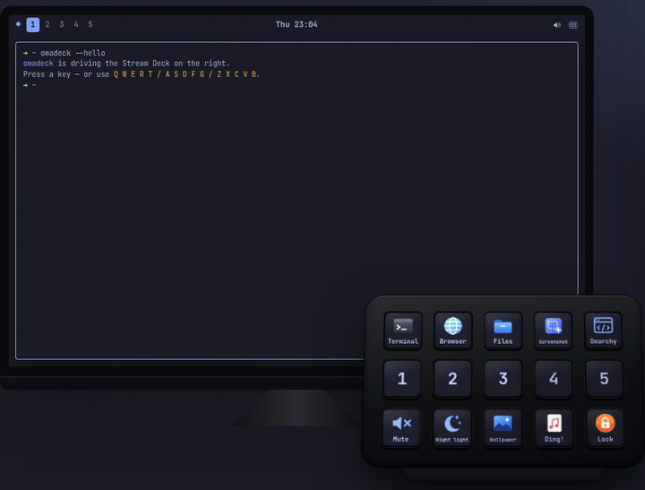
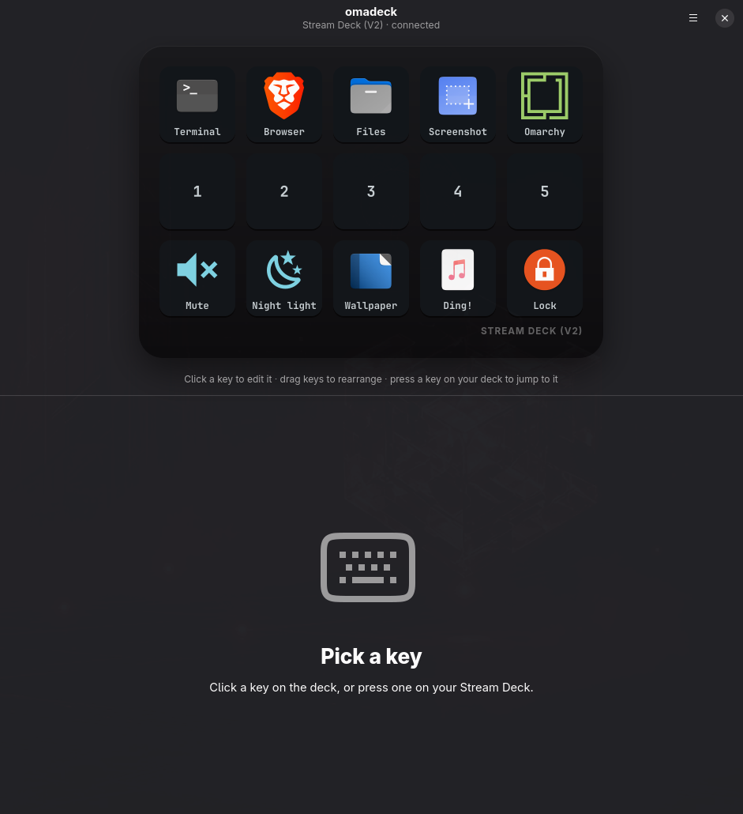
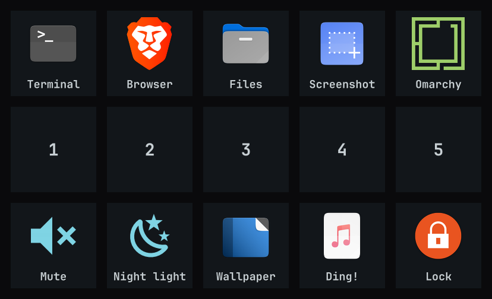

<h1 align="center"><br>omadeck</h1>

<p align="center">
  <b>Elgato Stream Deck support for <a href="https://omarchy.org">Omarchy</a>.</b><br>
  Launch apps, run scripts, play sounds, open websites and drive Hyprland, with your theme on every key.
</p>

<p align="center">
  <a href="https://github.com/thewizster/omadeck/actions/workflows/ci.yml"></a>
  <a href="https://github.com/thewizster/omadeck/releases/latest"></a>
  <a href="LICENSE"></a>
</p>

<p align="center">
  <a href="https://omadeck.app/"><b>Website and live demo</b></a> ·
  <a href="#install">Install</a> ·
  <a href="#roadmap">Roadmap</a>
</p>

<p align="center">
  
</p>

Written in Rust: a tiny background daemon drives the hardware, and a GTK4/libadwaita app lays out your keys.

<p align="center">
  
</p>

## Features

- **Six action types**
  - **Launch app:** pick from your installed apps; the app's icon and name come along. Apps launch through `uwsm-app`, the same way Omarchy launches them.
  - **Run script:** optionally in a terminal so you can watch the output.
  - **Play sound:** through PipeWire (`pw-play`), with per-key volume.
  - **Open website:** one click fetches the site's icon for the key. The icon is requested from the site itself; DuckDuckGo's icon service is used only if the site offers none, and the app tells you when that happens.
  - **Hyprland:** any dispatcher. Lua (`hl.dsp.focus({ workspace = "3" })`) is passed straight to `hyprctl dispatch`. Classic syntax (`workspace 3`, `movetoworkspace 2`, `togglefloating`, `fullscreen`, `killactive`, `exec …`) is translated automatically on Hyprland versions that use a Lua config.
  - **Open page:** pages and folders, for more keys than your deck has. A new page starts with a Back key, so a key that opens it works like a folder.
- **Icons your way**
  - PNG, JPEG, SVG, WebP or GIF images.
  - App icons from your icon theme.
  - **Nerd Font glyphs**, drawn in your theme's accent colour.
  - Labels are rendered in your Omarchy font.
- **Theme aware.** Key backgrounds, labels, glyphs and the press highlight come from the active Omarchy theme. Run `omarchy theme set …` and the deck re-renders instantly.
- **Live editing.** Changes land on the hardware as you type, and the deck shows whichever page you're editing. Drag keys to rearrange them. Press a physical key to jump to it in the editor.
- **Robust.** Reconnects after unplug/replug, and a typo in a hand-edited config keeps the last good layout on the deck. Apps opened from the deck keep running when the daemon restarts or upgrades. Uses about 9 MB of RAM and 0% CPU at idle.
- **Undo and backups.** A deleted page or cleared key can be undone, and the app keeps backups of your config.
- **Hold keys.** A key can do one thing when pressed and another when let go: push-to-talk to your AI agent with voxtype.
- **On your Omarchy bar.** An optional icon shows whether the deck is connected and which page it's on, and opens the app.
- **Portable.** Everything lives in `~/.config/omadeck/`, and imported icons are copied into it, so you can copy that folder to another machine.

<p align="center">
  
</p>

## Install

### Prebuilt release (recommended, no Rust needed)

```bash
curl -LO https://github.com/thewizster/omadeck/releases/download/v0.3.0/omadeck-0.3.0-x86_64-linux.tar.gz
curl -LO https://github.com/thewizster/omadeck/releases/download/v0.3.0/SHA256SUMS
sha256sum -c SHA256SUMS
tar xzf omadeck-0.3.0-x86_64-linux.tar.gz && cd omadeck-0.3.0-x86_64-linux
scripts/install.sh
```

The installer uses the prebuilt binaries, enables the `omadeckd` user service and offers to set
up the udev rule (details below). If the deck isn't detected straight away, replug it once.

**Coming soon:** `omarchy pkg add omadeck-bin` from the Omarchy Package Repository. The package
is in review.

### From source

```bash
# Rust toolchain, if you don't have one yet
mise use -g rust@latest

git clone https://github.com/thewizster/omadeck && cd omadeck
scripts/install.sh
```

The script:

- builds a release binary (pinned to `Cargo.lock`), or uses the prebuilt ones from a release tarball, and installs `omadeck` + `omadeckd` to `~/.local/bin`;
- adds a launcher entry;
- enables the `omadeckd` systemd **user** service, which starts with your graphical session;
- if your user can't already open the deck, shows the udev rule and the exact `sudo` commands, and runs them only if you answer `y`.

To remove omadeck, run `scripts/uninstall.sh`. It also removes the Omarchy bar widget, and leaves your config in place.

### Supported hardware

omadeck speaks to decks through the [`elgato-streamdeck`](https://crates.io/crates/elgato-streamdeck) crate.

| Model | Status |
|-------|--------|
| Stream Deck (V2), 15 keys | ✅ Tested |
| Stream Deck Original / MK.2, 15 keys | Expected to work |
| Stream Deck Mini / Mini MK.2, 6 keys | Expected to work |
| Stream Deck XL / XL V2, 32 keys | Expected to work |
| Stream Deck Neo, 8 keys | Keys expected to work; info screen and touch keys unsupported |
| Stream Deck +, 8 keys | Keys expected to work; dials and touch strip unsupported |
| Stream Deck Pedal | Not supported (no display) |

Got one of the untested models? Please [file a hardware report](https://github.com/thewizster/omadeck/issues/new?template=hardware_report.yml), whether it works or not.

## Use it

Open **omadeck** from the launcher (<kbd>Super</kbd>+<kbd>Space</kbd>). On first run you get a starter layout:

| Row | Keys |
|-----|------|
| 1 | Terminal · Browser · Files · Screenshot · omarchy.org |
| 2 | Workspaces 1–5 (Hyprland) |
| 3 | Mute · Night light · Next wallpaper · a sound · Lock |

Click any key to change it, or clear it with the trash button. The ▶ button tests the action without touching the deck.

### Pages and folders

The switcher above the deck picks the page you're editing; **+** adds a page, and the pencil and trash buttons rename or delete it. To make a folder, set a key to **Open page** and click **New page**: you get a page with a Back key already in place, and the key gets a folder symbol. Open it with **›** to fill it.

On the deck, **Go back** returns to the page you came from, or Home. Renaming a page updates every key that opens it.

### Hold keys (push-to-talk)

A key can also do something when you let go of it: set **When released** in the editor. With
[voxtype](https://voxtype.io) (Omarchy's dictation), a key that runs
`voxtype record start` when pressed and `voxtype record stop` when released gives you
push-to-talk: hold it, speak to your AI agent, let go. If the deck is unplugged or the service
stops while you're holding a key, it's let go then, so nothing stays switched on.

### Omarchy bar

On Omarchy, the app offers once to add an omadeck icon to the bar. It shows whether your deck
is connected and which page it's on, and opens omadeck when clicked. Turn it on or off any time
with **Show in Omarchy bar** in the app's settings (or `omarchy plugin disable dev.omadeck`).

### Command line

```text
omadeckd                        run the daemon (normally via systemd)
omadeckd list                   show connected decks
omadeckd press 3 [PAGE]         run key 3's action, then its release action (keys count from 0)
omadeckd snapshot x.png [PAGE]  render the layout to an image
omadeckd status [--follow]      the deck's state as Waybar-style JSON (keeps printing with --follow)
```

`omadeckd press` is handy in Hyprland bindings and scripts, for example to share one action between a key and a keyboard shortcut.

## Configuration

The config file is `~/.config/omadeck/config.toml`. The app edits it for you, but it's plain TOML and safe to edit by hand, even while the app is open; the daemon and the app reload it as soon as you save. If the app can't read your edit, it shows the error and leaves the file alone until you fix it. See [`examples/config.toml`](examples/config.toml).

Each time the app opens, and before it deletes a page, it keeps a copy of `config.toml` in `~/.local/state/omadeck/backups` (the newest 20). Deleting a page or clearing a key can also be undone from the notice that pops up.

```toml
brightness = 70

[style]
follow_theme = true            # colours from the active Omarchy theme

[[key]]
index = 0                      # left-to-right, top-to-bottom, from 0
label = "Terminal"
icon = "icons/utilities-terminal.png"   # relative to ~/.config/omadeck
[key.action]
type = "app"
command = "xdg-terminal-exec"  # or a desktop id like "firefox.desktop"

[[key]]
index = 10
label = "Mute"
glyph = "\U000F075F"           # Nerd Font symbol (or "f075f" / "U+F075F")
[key.action]
type = "app"
command = "omarchy audio output volume mute-toggle"

[[key]]
index = 4
label = "Media"
glyph = "\U000F024B"
[key.action]
type = "page"                  # open another page
page = "Media"

[[page]]                       # top-level [[key]]s are the Home page; more pages go here
name = "Media"

[[page.key]]
index = 0
label = "Back"
[page.key.action]
type = "back"                  # previous page, or Home
```

Action types:

| `type` | Fields |
|--------|--------|
| `app` | `command` |
| `script` | `path`, `terminal` |
| `sound` | `file`, `volume` (0.0–1.5) |
| `url` | `url` |
| `hyprland` | `dispatch` |
| `page` | `page` (a page `name`) |
| `back` | |

A key's `[key.on_release]` (or `[page.key.on_release]`) takes any of these except `page` and
`back`, and runs when the key is let go.

Per-key look overrides are `background`, `label_color` and `show_label`.

## How it works

```
crates/
  omadeck-core/   config, Omarchy theme, key renderer, actions, IPC types
  omadeckd/       daemon: owns the USB device, paints keys, runs actions
  omadeck-gui/    GTK4 + libadwaita configurator (binary: omadeck)
packaging/        systemd unit, udev rule, desktop entry, AUR PKGBUILDs
scripts/          install / uninstall / package a release
site/             project website: static HTML/CSS/JS with an interactive demo
```

- **Single source of truth.** The GUI only writes `config.toml` (atomically). The daemon watches it, plus Omarchy's theme state in `~/.local/state/omarchy/current`, and repaints.
- **Same pixels everywhere.** The renderer in `omadeck-core` is shared, so the previews in the app are rendered by the same code that paints the hardware.
- **Event feed.** The daemon publishes connect/disconnect, page and key events as JSON lines on `$XDG_RUNTIME_DIR/omadeck.sock`. The app uses this for its status line, press-to-select and following the deck's page, and sends back the page you're editing so the deck can show it.

## Troubleshooting

- **"Service not running"**: `systemctl --user status omadeckd` (press <kbd>q</kbd> to leave its pager, or add `--no-pager`). Logs: `journalctl --user -u omadeckd -f`.
- **Deck found but can't be opened** (the app's title says "Can't open the Stream Deck"): replug the deck. If that doesn't help, install the udev rule (`packaging/70-omadeck.rules` → `/etc/udev/rules.d/`), then replug it again.
- **Only one program can own the deck.** Quit the Elgato software or other tools such as `streamdeck-ui` first.

## Roadmap

Ideas, roughly in order; [docs/ROADMAP.md](docs/ROADMAP.md) has the details. Want one sooner? Open an issue; see [CONTRIBUTING](CONTRIBUTING.md).

- [x] **Pages and folders** (0.2.0)
- [x] **Release actions**: keys that act on release too, for push-to-talk dictation (0.3.0)
- [x] **Omarchy bar widget**: deck status on the bar, one click to the app (0.3.0)
- [ ] **Templates**: ready-made pages to add in one click, starting with Omarchy Basics (your AI agent, dictation and everyday Omarchy keys); save any page as a template and share it
- [ ] **Toggle keys** with on/off faces (mute, night light, …) that reflect real state
- [ ] **Multi-actions**: run several actions from one key, with optional delays
- [ ] **Stream Deck +**: dials and touch strip (volume, brightness, scrubbing)
- [ ] **OBS** scene and recording keys via obs-websocket
- [ ] **Live keys** that show a clock, CPU usage or the active workspace
- [ ] **Multiple decks** with a layout per serial number

## How this was built

omadeck was built on Omarchy by Raymond Brady together with Claude Code (Anthropic's AI coding agent), as a showcase of what that pairing can do. Every change goes through the same checks as any contribution: `rustfmt`, `clippy -D warnings`, tests, CI and testing on real hardware.

## License

MIT © Raymond Brady
